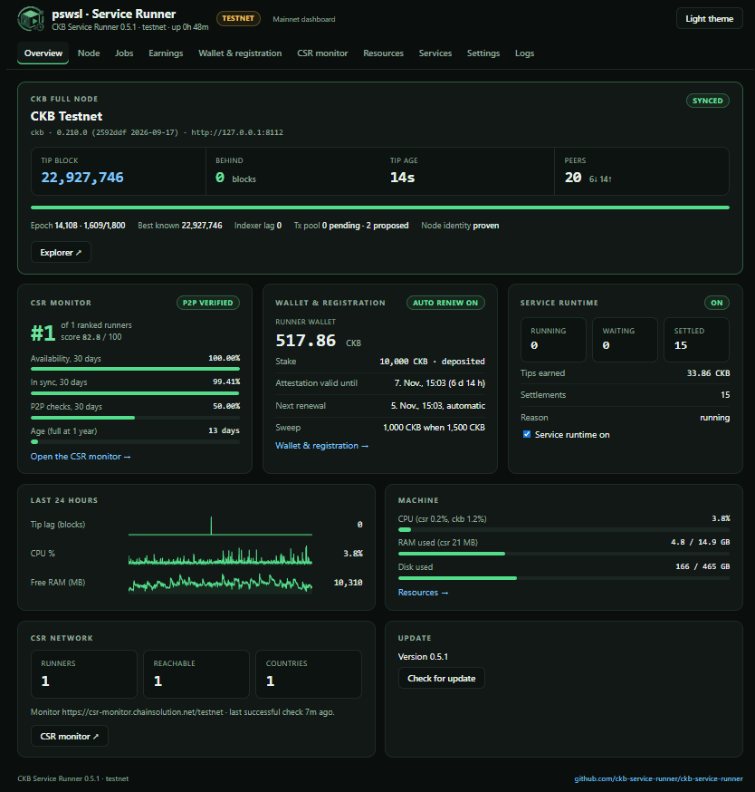
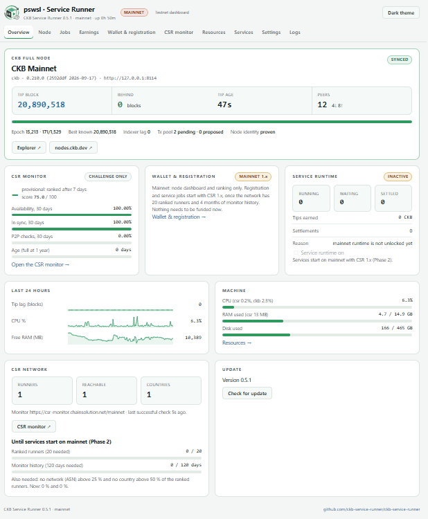
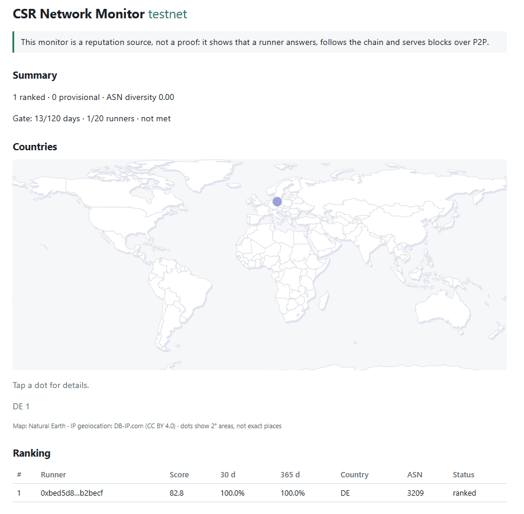

# CKB Service Runner (CSR)

**Run a CKB full node. Let it do more.**

CSR installs beside your [CKB](https://github.com/nervosnetwork/ckb) full node in five minutes. It gives the node a
dashboard, a place in a public ranking of independent full nodes, and a sandboxed runtime that runs decentralised
services and earns tips. It never changes your node or its `ckb.toml`.

[](https://github.com/ckb-service-runner/ckb-service-runner/releases/latest)
[](LICENSE)
[](https://csr-monitor.chainsolution.net)
[](https://t.me/ckbrunner)

<p align="center">
  
</p>

## Install

On Ubuntu/Debian x86_64, beside a synced CKB full node (testnet, mainnet or both):

```sh
curl -fLO https://raw.githubusercontent.com/ckb-service-runner/ckb-service-runner/main/scripts/install.sh
sudo bash install.sh
```

The installer finds every CKB node on the machine and sets up one CSR instance per network: the testnet dashboard on
port 8130, mainnet on 8140. Prerequisites, options and the manual steps: **[quick start](docs/quickstart.md)**.

## What works today

| | Testnet | Mainnet |
|---|---|---|
| Node dashboard and full-node checks | ✅ | ✅ |
| Public ranking and network map ([live](https://csr-monitor.chainsolution.net)) | ✅ | ✅ ranked after 7 days |
| Service runtime: run jobs, earn tips | ✅ | from release **1.x** |
| Registration with a Nervos DAO stake | ✅ | from release **1.x** |

**Mainnet: node dashboard only, for now.** The service runtime starts on mainnet with the **1.x** release, once the
network meets the Phase 2 gate: at least **4 months** (120 days) of monitor history and **20 ranked runners**, with no
network (ASN) holding more than 25 % and no country more than 50 % of them. Ranking needs **no registration**: a
registration is only needed to get service jobs. Every new runner brings that gate closer.

<table>
  <tr>
    <td width="50%"></td>
    <td width="50%"></td>
  </tr>
  <tr>
    <td align="center">Mainnet dashboard (light theme), with the Phase 2 gate progress</td>
    <td align="center">The public CSR Network Monitor</td>
  </tr>
</table>

## How it works

CSR is a Rust side application: one binary, `csr`, with an embedded web dashboard (no separate web server, no build
step). It talks to the node over local RPC only.

What the runner does:

- **Full-node check (R2).** Is the node synced, connected and indexed? The RPC must be loopback. The check is read once per block;
  no new run starts while it fails.
- **Ranking.** With `ranking.join = true` the CSR Network Monitor pings the node (inbound or outbound), checks it daily over P2P and ranks it.
- **Node identity.** The service key and the node's P2P key sign a binding, so the monitor can prove that the service key belongs to the node's peer ID.
- **Services in a RISC-V sandbox (CKB-VM).** Approved services run with a small host interface (`spec/host-interface.md`), encrypted storage and limits.
- **Jobs and tips.** With `runtime.enabled = true`, `csr run` discovers job cells, runs the approved service, sends the run transaction and collects the **tip**.
- **Runner wallet.** The plain cells of the runner's own key: it pays the registration and the fees, receives the tips and sweeps surplus to your address.
- **Registration with a Nervos DAO stake.** A registry cell references a DAO deposit of at least 10,000 CKB that stays in your wallet; you consent once by signing a text.

What it signs and sends: CSR signs with its **service key** only (`<data-root>/<network>/keys/`). It sends the transactions of the
runner wallet: registration (create, update, refresh), removal of the registration, job settlements (run transactions), sweeps to
your `sweep_address` and `csr wallet send`. It never signs for your own wallet: the stake owner signs one line of text in
their wallet (Neuron "Sign message"), nothing else.

## Build from source

The [full installation guide](docs/install.md) covers updates, remote access and uninstalling.


```sh
. "$HOME/.cargo/env"
cargo build --release
./target/release/csr version
```

## Commands

```sh
csr detect            # inspect the configured node (add --probe to try 127.0.0.1:8114 and :8124)
csr check             # one R2 check; exit 0 = Synced, 2 = not Synced / unreachable
csr set-password      # optional: protect the dashboard
csr run               # start the service (testnet by default); Ctrl-C / SIGTERM stops it
```

`csr detect` tells you if the node is reachable, which chain it serves, and whether the Indexer module is enabled.
If it is not, add `"Indexer"` to `modules` under `[rpc]` in `ckb.toml` yourself and restart the node.

Global options: `--data-root DIR` (default `~/.csr`), `--config FILE` (default `<data-root>/csr.toml`; built-in defaults if absent),
`--network testnet|mainnet`. Mainnet needs `csr run --confirm-mainnet` once.

## Configuration

Copy `config/csr.example.toml` to `~/.csr/csr.toml`. Every key is optional, unknown keys are errors, and `csr config validate`
checks a file without creating anything. The main sections: `[node]` (RPC URL, loopback only), `[dashboard]` (bind address, password hash),
`[ranking]` (join, ping mode and port), `[monitor]`, `[runtime]`, `[limits]`, `[storage]`, `[logging]`.
Per-network state lives in `<data-root>/<network>/` (keys, SQLite database, logs).

## Dashboard

Open `http://127.0.0.1:8130/` after `csr run`. A non-loopback bind requires a password (`csr set-password`). All writes need the session cookie and the CSRF token.

| Page | Content |
|---|---|
| Overview (`#/overview`) | status of node, ranking, runtime and wallet |
| Node (`#/node`) | chain, tip, indexer, tx pool, peers, tip lag |
| Network (`#/network`) | CSR network map, countries, your rank, availability (7/30/365 d), check type (`peer_connected`, `p2p_verified`, `none`), identity proven, attestation, stake |
| Resources (`#/resources`) | CPU, RAM, disk, history |
| Services (`#/services`) | local and on-chain services; approve, revoke, enable, disable |
| Jobs (`#/jobs`) | discovered jobs and their runs |
| Earnings (`#/earnings`) | tips and settlements |
| Wallet & registration (`#/wallet`) | runner address, balance, send, stake, consent text, register / remove |
| Logs (`#/logs`) | recent events |
| Settings (`#/settings`) | configuration |

JSON API (`web/routes.rs`): `GET /healthz`, `GET /api/status`, `/api/node`, `/api/network`, `/api/resources`, `/api/resources/history`, `/api/logs`,
`/api/session`, `POST /api/login`, `GET|PUT /api/settings`, `GET /api/services`, `POST /api/services/{hash}/{verb}`, `GET /api/runner-cell`,
`/api/wallet`, `POST /api/wallet/send`, `GET /api/registry`, `POST /api/registry/consent-message`, `/api/registry/create`, `/api/registry/remove`,
`GET /api/jobs`, `/api/jobs/{id}`, `/api/earnings`, `/api/events`. The Network page is fed by the monitor's public API (`spec/monitor-public-api.md`, cached 5 min; stale data is flagged).

## Ranking (ping responder)

With `ranking.join = true` the CSR Network Monitor can verify that your node is online, synced and bound to your service key.

- `ping_mode = "inbound"`: CSR listens on `ranking.ping_bind` (default `0.0.0.0:8131`) and answers signed challenges at `POST /v1/challenge`.
- `ping_mode = "outbound"`: for nodes behind NAT. CSR checks in with the monitor every 10 minutes and answers the challenge it gets back. The ping port stays closed.
- `ping_mode = "both"`: both.

Protocol details: `spec/ping-protocol.md`. The default monitor URL and key per network are in `config/networks/`.

## Services and jobs
Build the example services with `bash scripts/build-services.sh`, then
`csr service run-local --manifest services/manifests/hello-rust.toml --payload 0x0102`.
Register with `csr service add-local --manifest PATH` or `csr service add-onchain`, manage with `csr service list|approve|revoke|enable|disable`
or on the dashboard. `csr jobs plan --json` shows the job selection. Host interface: `spec/host-interface.md`; job cells: `spec/job-cell-standard.md`.

## Runner wallet, stake and registration

Setup needs one transfer and one signed message; tips collect in the runner wallet and are swept to your address.

**First transfer.** Send **700 CKB** to the runner address (`csr identity`, `csr wallet status`, or the page "Wallet & registration") once, from any wallet. It is computed from
the registry cell of the v3 registry contract: 8 (capacity) + 97 (dual lock, 64-byte args) + 65 (type, 32-byte args) + 369 (data with a 46-character peer ID) = **539 CKB**, plus the
fee (below 1 CKB) and a change cell of at least 61 CKB, which makes about 601 CKB; 700 CKB leaves headroom for the runner's later fees. Other documents refer to this section instead of repeating the number.

The **runner wallet** is the set of plain cells of the runner's own key. The job **tips** go into it. With `[payout] sweep_address` set, the runner sends `sweep_amount_ckb` (default 1,000) there whenever the wallet holds `sweep_threshold_ckb` (default 1,500); `csr wallet send --to ADDRESS --ckb N` sends by hand.

A registration references a **stake**: a Nervos DAO deposit of at least 10,000 CKB that stays in the operator's wallet. Its owner consents by signing one line of text ("Sign message" in Neuron): `csr register consent-message --stake 0x<tx>:<index>` prints it, `csr register create --stake … --consent 0x<signature>` registers (CSR signs the transaction itself), `csr register remove` returns the registry cell's CKB to the wallet. Details: `spec/registry.md` §4.2 and §9, `docs/decisions.md` (D-A8-1).

## What it costs an operator

**The dashboard and the ranking cost nothing**: install CSR, join the ranking, no CKB needed.

To run **service jobs** (testnet now, mainnet from 1.x) a runner registers once:

| Item | Amount | Where it stays | Back? |
|---|---|---|---|
| Stake: Nervos DAO deposit | at least **10,000 CKB** | your own wallet, still in the Nervos DAO (keeps earning DAO interest) | yes, by a normal DAO withdrawal (then the registration ends) |
| First transfer to the runner wallet | **700 CKB** once | runner wallet; **539 CKB** of it is locked in the registry cell | yes: `csr register remove` returns the registry cell, the rest stays in the runner wallet |
| Transaction fees | below 1 CKB each (registration, refreshes, sweeps) | spent | no |

Only the fees are spent; the stake and the 700 CKB come back. The arithmetic of the 700 CKB is in
[Runner wallet, stake and registration](#runner-wallet-stake-and-registration). Jobs pay their own transaction fees;
their **tips** go into the runner wallet, which sends 1,000 CKB to your `sweep_address` whenever it holds 1,500 CKB
(defaults). The runner wallet is a hot key on the node: at most the 700 CKB and the unswept tips are exposed, never the
stake. Testers on testnet can ask the project for the 10,000 testnet CKB stake.

## Documents

| Document | Content |
|---|---|
| [`docs/quickstart.md`](docs/quickstart.md) | install and run CSR (start here) |
| [`docs/install.md`](docs/install.md) | full installation guide: updates, rollback, remote access, uninstall |
| [`docs/architecture.md`](docs/architecture.md) | how the runner is built |
| [`docs/roadmap.md`](docs/roadmap.md), [`docs/open-questions.md`](docs/open-questions.md) | what is done and what is open |
| [`docs/decisions.md`](docs/decisions.md) | design decisions and their reasons |
| [`docs/testing.md`](docs/testing.md), [`docs/release.md`](docs/release.md) | devnet tests, making a release (developers) |
| [`spec/`](spec/) | registry, job cells, host interface, ping protocol, monitor API |
| [`CHANGELOG.md`](CHANGELOG.md) | changes per release |
